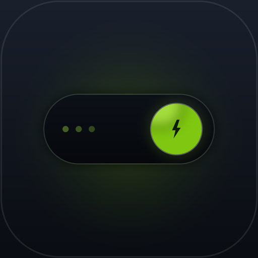
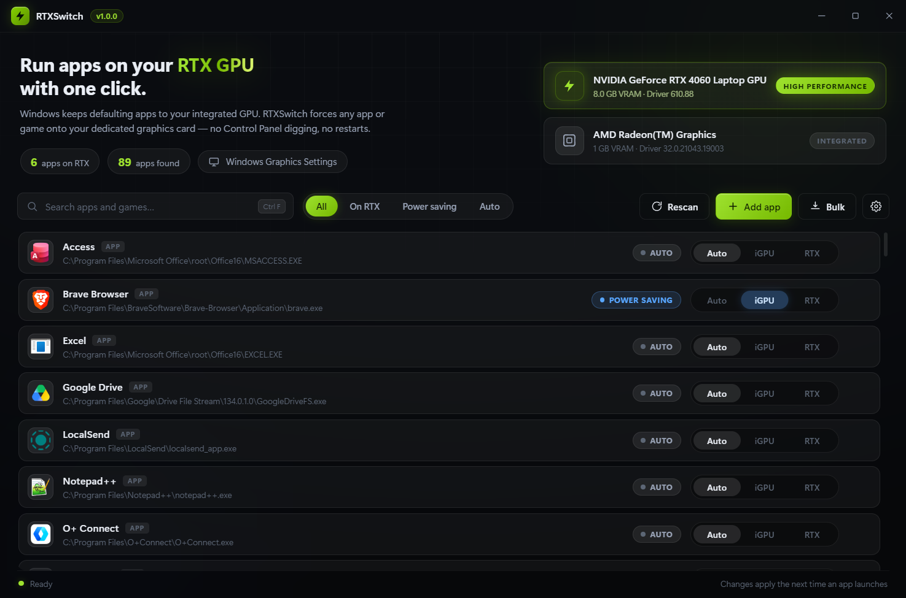
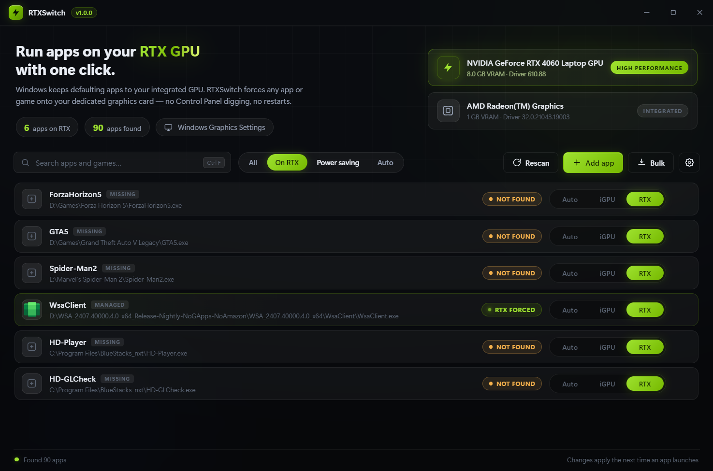
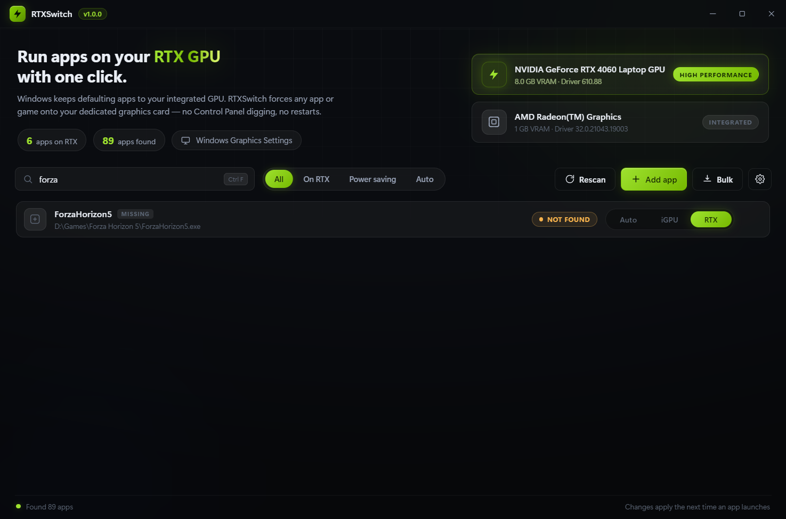
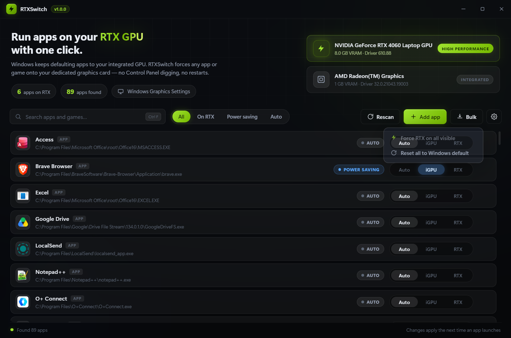
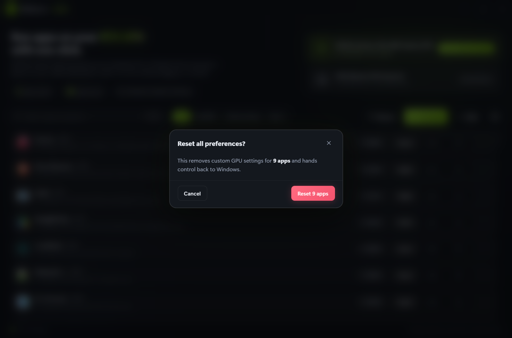
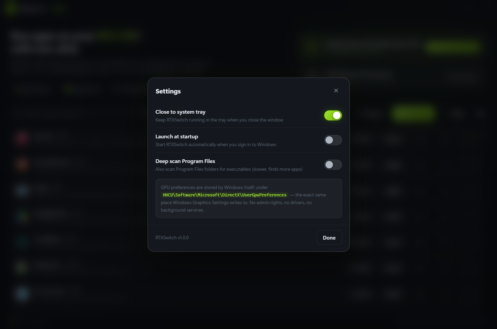
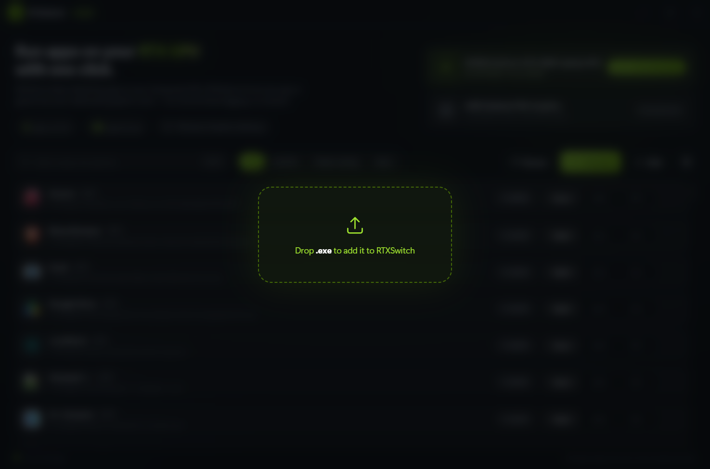
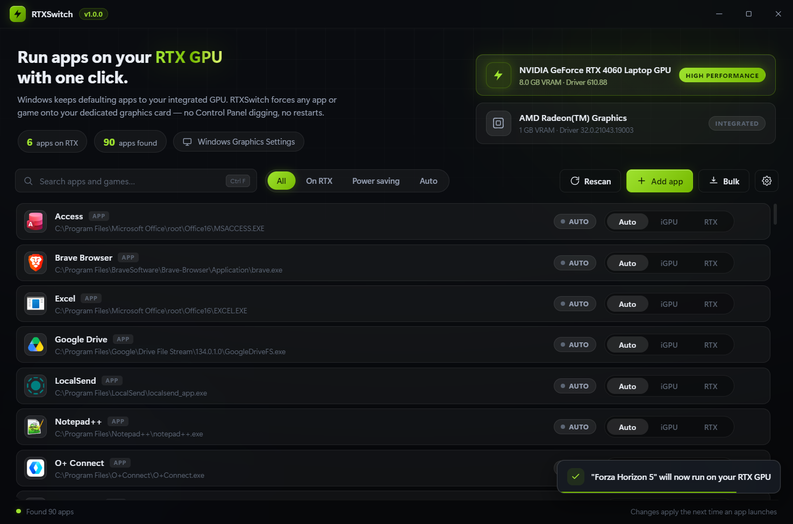

<div align="center">



# RTXSwitch

**Force any app or game to run on your NVIDIA RTX / dedicated GPU instead of integrated graphics — with one click.**

[](../../releases/latest)
[](#)
[](LICENSE)

*No admin rights · No drivers · No background services · 100% offline*

</div>

---

<p align="center">
  
</p>

Laptops with AMD or Intel integrated graphics often run apps and games on the
**integrated GPU** by default — even when an **NVIDIA RTX 4060 / 4070 / 5060…**
is sitting right there. RTXSwitch fixes that: pick an app, hit **RTX**, and
Windows will launch it on your dedicated graphics card from then on.

It uses the **official Windows per-app GPU preference system** — the exact same
one behind *Settings → System → Display → Graphics* — so behavior is identical
to Windows itself, just instant and 100× faster to use.

## 📸 Screenshots

| | |
|:---:|:---:|
| **Live GPU detection** | **“On RTX” filter** |
|  |  |
| **Instant search** | **Bulk actions** |
|  |  |
| **Safe confirmation dialogs** | **Settings** |
|  |  |
| **Drag & drop any .exe** | **Toast feedback** |
|  |  |

## ✨ Features

- 🔍 **Auto-discovers your installed apps & games** — Start Menu, Steam libraries, Epic Games
- ⚡ **One-click GPU switching** — Auto / Power saving (iGPU) / RTX (high performance) per app
- 🎮 **Live GPU detection** — shows your RTX model, VRAM and driver version
- 📦 **Drag & drop** any `.exe` to add it
- 🧹 **Bulk actions** — force RTX on everything visible, or reset all to Windows default
- 🔎 Instant **search & filters** (On RTX / Power saving / Auto)
- 🗂️ Preserves Windows' own settings (like `SwapEffectUpgradeEnable`) when editing
- 🧠 Flags stale entries — apps you uninstalled show as *Not found*, easy to clean up
- 🖥️ Close-to-tray, launch-at-startup, single-instance
- 🎨 Premium dark UI with smooth animations — built with Electron

## ⬇️ Install

1. Grab **`RTXSwitch-Setup-1.0.1.exe`** from the [**Releases**](../../releases/latest) page
2. Run it — installs per-user, **no administrator rights needed**
3. Pick an app, click **RTX**, done ✅

> Windows 10 (1803+) and Windows 11 supported. Works with NVIDIA, AMD and Intel GPUs —
> RTXSwitch simply assigns whichever GPU you choose as "high performance".

## 🚀 Usage

| Toggle | Meaning |
|---|---|
| **Auto** | Let Windows decide (default) |
| **iGPU** | Power saving — integrated GPU (saves battery) |
| **RTX** | High performance — dedicated GPU, always |

Changes apply **the next time the app launches** (already-running apps need a restart).
You can also double-click any row to launch the app right from RTXSwitch.

## ⚙️ How it works

RTXSwitch reads and writes one registry key — nothing more, nothing hidden:

```
HKCU\Software\Microsoft\DirectX\UserGpuPreferences
```

Each app gets a string value like `GpuPreference=2;` (`0` = auto, `1` = power saving,
`2` = high performance). This is Microsoft's documented per-app GPU mechanism,
identical to what Windows Graphics Settings writes — RTXSwitch just makes it
instant, searchable, and one-click.

Your existing values (including Windows' own flags such as
`SwapEffectUpgradeEnable=1;`) are always preserved — only the GPU segment changes.

## ❓ FAQ

<details>
<summary><b>How do I force a game to use my dedicated GPU on Windows 11?</b></summary>
Open RTXSwitch, find the game, click <b>RTX</b>, then (re)launch the game. Windows will now
run it on the dedicated GPU. This is the same mechanism as Settings → Display → Graphics,
so it works system-wide.
</details>

<details>
<summary><b>Why are my apps using the integrated GPU instead of my RTX?</b></summary>
Windows defaults unknown apps to the "power saving" GPU on hybrid-graphics laptops
(or the app itself requests it). Setting the per-app preference to <b>High performance</b>
overrides that behavior.
</details>

<details>
<summary><b>Does RTXSwitch need administrator rights?</b></summary>
No. It writes to <b>HKEY_CURRENT_USER</b> only, exactly like the Windows Settings app does.
No UAC prompt, no elevation, no services.
</details>

<details>
<summary><b>Will it work with NVIDIA Control Panel / GeForce Experience?</b></summary>
Yes — they don't conflict. NVIDIA Control Panel uses NVIDIA's own profiles; RTXSwitch uses
Windows' per-app preference. Both can coexist, and either can force the dGPU.
</details>

<details>
<summary><b>Does it work on Windows 10?</b></summary>
Yes — Windows 10 version 1803 and newer support per-app GPU preferences, plus all Windows 11 versions.
</details>

<details>
<summary><b>How do I undo it?</b></summary>
Set the app back to <b>Auto</b>, or use <b>Bulk → Reset all to Windows default</b>.
RTXSwitch removes its entries cleanly.
</details>

<details>
<summary><b>Will forcing the RTX kill my battery?</b></summary>
Only for the apps you switch. That's why the three-way toggle exists — keep browsers and
background apps on <b>iGPU / Auto</b>, and force <b>RTX</b> for games and heavy apps only.
</details>

<details>
<summary><b>My app still uses the iGPU — why?</b></summary>
Some apps spawn helper executables; each helper may need its own entry (drag the helper
`.exe` in as well). Also make sure the app was fully closed and relaunched — preference
changes apply at launch time.
</details>

## 🔑 Search terms

`force app to use dedicated gpu` · `force game to use nvidia gpu windows 11` ·
`switch from integrated to dedicated gpu` · `rtx 4060 not being used fix` ·
`gpu preference windows 11` · `high performance gpu per app` ·
`amd integrated graphics switch to nvidia` · `game runs on wrong gpu` ·
`hybrid graphics laptop gpu switcher` · `GpuPreference registry`

## 🛠️ Build from source

```bash
npm install
npm start        # run in dev
npm run dist     # build the NSIS installer → dist/
```

Requires Node.js 18+. Windows 10/11.

## 📄 License

[MIT](LICENSE) — free for personal and commercial use.

<div align="center">
  <sub>Built with ⚡ by <a href="https://github.com/Shishir-ip">Shishir</a> — if it saved you a trip into Windows Settings, star the repo ⭐</sub>
</div>
